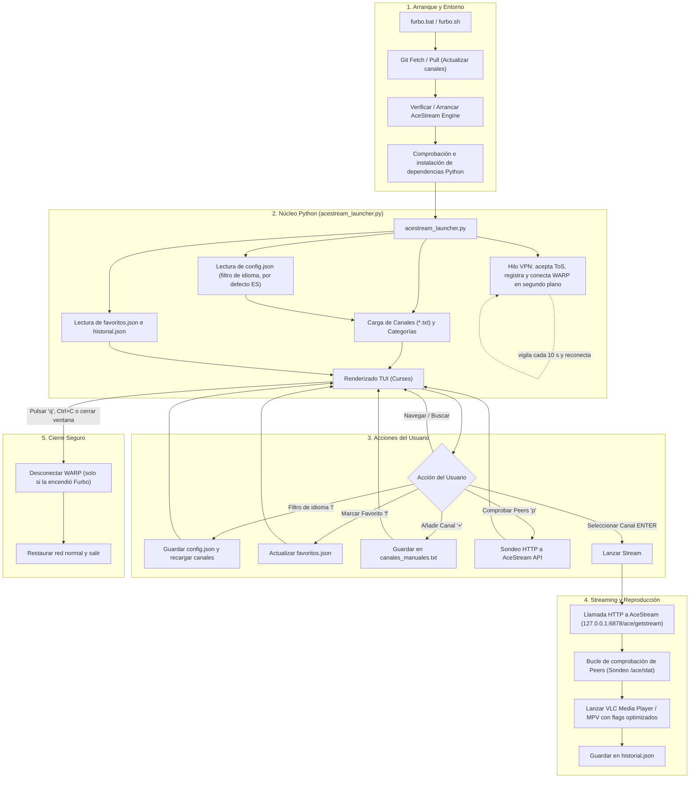

# ⚽ Furbo (AceStream TV) — Documentación Técnica y de Funcionamiento

Esta guía explica en detalle la arquitectura interna, el ciclo de vida de ejecución, los módulos y la lógica de funcionamiento del proyecto **Furbo**.

---

## 1. Visión General del Proyecto

**Furbo** es una plataforma cliente ligera diseñada para automatizar y simplificar la visualización de emisiones deportivas y canales de televisión mediante tecnología P2P (**AceStream**) en **Windows** y **Linux**.

### Objetivos Clave:
* **Cero fricción técnica para el usuario final:** Automatiza la instalación de dependencias, la detección del motor de streaming y la configuración del reproductor de vídeo.
* **Evasión de bloqueos de operadoras:** Integra de forma transparente conexiones cifradas mediante **Cloudflare WARP** (y proxy Tor en Linux) para evitar el bloqueo selectivo de IPs y dominios de streaming.
* **Interfaz ágil en terminal (TUI):** Utiliza una interfaz interactiva basada en `curses` que permite navegar por categorías, buscar en tiempo real, gestionar favoritos y consultar métricas de la red sin consumir apenas memoria ni CPU.

---

## 2. Mapa Conceptual de Arquitectura

El siguiente diagrama muestra el flujo completo desde que el usuario ejecuta la aplicación hasta que se visualiza el contenido en el reproductor de vídeo:



---

## 3. Componentes y Módulos del Sistema

### 3.1. Lanzadores del Sistema (`furbo.bat` y `furbo.sh`)
Son el punto de entrada principal para el usuario y se encargan de orquestar el entorno antes de invocar a Python:
1. **Auto-actualización con GitHub:** Ejecutan `git fetch` y comparan revisiones locales contra el repositorio remoto. Si hay cambios en los canales o el programa, descargan automáticamente la última versión con `git pull`.
2. **Detección activa del proceso de AceStream:** Inspeccionan la lista de procesos activos (`tasklist` en Windows o `curl` al puerto `6878`). Si `ace_engine.exe` no está corriendo, buscan su ruta física en el disco o en el registro de Windows y lo inician en segundo plano.
3. **VPN Antibloqueo:** Ya no la tocan los lanzadores. La gestiona por completo `acestream_launcher.py` (ver 3.2.E), lo que evita que se conecte/desconecte dos veces y que se quede a medias en PCs donde WARP no estaba aceptado/registrado.
4. **Verificación preventiva de librerías:** Comprueban si el intérprete actual de Python puede importar `curses`. Si no es así, llaman a `pip install` para instalar `windows-curses>=2.4.2` de forma desatendida.
5. **Actualización segura:** `furbo.bat` usa `git pull --ff-only --autostash` para no bloquearse si el usuario tiene canales modificados en local, y avisa si no pudo actualizar. Si Python falla, indica que el detalle está en `backend/acestream_error.log`.

---

### 3.2. El Motor de la Interfaz: `acestream_launcher.py`
Es el corazón de Furbo (escrito en Python 3 puro utilizando la librería `curses`).

#### A. Carga y Parsing de Canales
Los canales se organizan en carpetas dentro del directorio `canales/`. Cada carpeta representa una categoría (por ejemplo: `la_liga`, `liga_de_campeones`, `formula_1`, `cadenas/dazn`, etc.).
* Dentro de cada carpeta hay un archivo `canales.txt` con el formato:
  ```text
  Nombre del Canal, Idioma, acestream://CONTENT_ID
  ```
* El launcher lee estos ficheros recursivamente, extrae el `CONTENT_ID` limpio y construye las URLs internas de streaming (`http://127.0.0.1:6878/ace/getstream?id=<CID>`).
* La línea se interpreta **cortando por la derecha** (`rsplit(",", 2)`), así que el nombre puede contener comas. El idioma se normaliza (`es`, `ESP`, `Español` → `ES`; vacío → `ES`).
* Un `canales.txt` da nombre a su carpeta; cualquier otro `.txt` suelto dentro de `canales/` se convierte en su propia categoría (antes solo se leía el primero de cada carpeta).
* Genera dinámicamente dos categorías virtuales especiales:
  * **`HISTORIAL (ÚLTIMOS REPRODUCIDOS)`:** Almacena los últimos 25 canales reproducidos con persistencia en `historial.json`.
  * **`TODOS LOS CANALES`:** Un catálogo unificado y alfabético de todos los canales indexados sin duplicados.

#### B. Sistema de Favoritos y Detección de Duplicados
* Si un canal tiene su ID en `favoritos.json`, se posiciona en lo más alto tanto del menú principal como dentro de su categoría.
* En la interfaz visual se resalta con **color dorado / destacado (★)** para localizarlo al instante.
* Si varios canales comparten el mismo nombre en un archivo, el sistema detecta la colisión y los renombra automáticamente añadiendo sufijos (`(1)`, `(2)`, etc.) para evitar confusiones.

#### C. Comunicación con el Motor AceStream (`AceStream Engine API`)
AceStream expone un servidor HTTP local en el puerto `6878`. Furbo interactúa directamente con sus endpoints REST:
* **`/webui/api/service?method=get_version`:** Se utiliza para verificar si el motor está encendido y respondiendo.
* **`/ace/stat/<content_id>`:** Devuelve en formato JSON las métricas en directo del stream: cantidad de peers conectados (`peers`), velocidad de descarga y estado del buffer (`dl`, `buf`, `prebuf`).
* **`/ace/getstream?id=<content_id>`:** Endpoint directo que transforma el flujo P2P en una señal multimedia continua consumible por cualquier reproductor compatible con HTTP/MPEG-TS.

#### D. Lanzamiento de VLC / MPV con Parámetros Optimizados
Cuando el usuario pulsa `ENTER` sobre un canal:
1. **Despertar el stream:** Se envía una petición HTTP en un hilo secundario (`threading.Thread`) simulando un cliente multimedia (`User-Agent: VLC/3.0.0`) para que el motor empiece a negociar paquetes con los peers inmediatamente.
2. **Monitoreo de Peers:** Se muestra una barra de carga interactiva con spinner en la consola mientras se espera a que se detecten peers activos.
3. **Ejecución del reproductor:**
   * En **Windows**, busca `vlc.exe` en las rutas habituales de Program Files y lo arranca con:
     ```bash
     vlc.exe --qt-minimal-view --meta-title "<Nombre>" --network-caching=5000 <URL_STREAM>
     ```
     *(El parámetro `--network-caching=5000` crea un buffer de 5 segundos para prevenir micro-cortes en transmisiones P2P).*
   * En **Linux**, ejecuta `mpv` con aceleración por hardware (`--hwdec=auto`, `--vo=gpu`) y buffers ampliados (`--demuxer-max-bytes=500M`).

#### E. Gestión automática de la VPN (Cloudflare WARP)
Todo vive en `acestream_launcher.py` y corre en un hilo en segundo plano, de modo que la interfaz arranca al instante:
1. **Sin interacción:** todas las llamadas usan `warp-cli --accept-tos ...` (y envían `y` por stdin para clientes antiguos que preguntan), por lo que ya no hay que abrir la app de WARP ni aceptar términos/cookies. Si el cliente es tan antiguo que no conoce `--accept-tos`, se detecta y se reintenta sin él.
2. **Registro automático:** si `warp-cli status` indica *Registration Missing* (o `connect` falla por eso), ejecuta `registration new` (o `register` en versiones antiguas). Si el servicio no está levantado, intenta arrancarlo (`sc start CloudflareWARP` en Windows).
3. **Conexión verificada:** tras `connect` consulta `warp-cli status` hasta ver *Connected* (máximo 30 s) en lugar de dar la conexión por hecha. Antes se usaba un timeout de 3 s que fallaba en PCs lentos.
4. **Vigilante:** cada 10 s (`VPN_WATCH_INTERVAL`) comprueba el estado y reconecta si WARP se ha caído, pausado o apagado a mano.
5. **Propiedad de la VPN:** solo se apaga al salir si la encendió Furbo. Para sobrevivir a cierres bruscos se guarda la marca `.warp_owned`; si la siguiente ejecución encuentra WARP conectada **y** la marca, sabe que es suya y la apaga al terminar. Si WARP estaba ya conectada por el usuario (sin marca), no se toca.
6. **Estado real en pantalla:** la cabecera muestra `[VPN: ● ON]`, `[VPN: ◌ ...]`, `[VPN: ○ OFF]` o `[VPN: sin WARP]` (antes ponía siempre `ON`). Al lanzar un canal con la VPN aún conectando, se espera hasta 20 s.
7. **Apagado garantizado:** `atexit`, `SIGINT`/`SIGTERM`/`SIGBREAK` y, en Windows, un manejador de cierre de consola (`SetConsoleCtrlHandler`) llaman a `stop_vpn()`, que es idempotente.

#### F. Filtro de idioma
* El idioma activo se guarda en `config.json` (`{"langs": ["ES"]}`; `"all"` = todos). **Por defecto solo `ES`**: los canales de otros idiomas se descartan en `load_categories()`, así que no aparecen en carpetas, favoritos, historial, "TODOS LOS CANALES" ni en la búsqueda.
* `load_categories()` también devuelve, para todos los canales (filtrados o no), el reparto `{idioma: {ids}}`. Con él se rellena el selector de la tecla `L` (idiomas con su número de canales) y se calcula cuántos canales están ocultos, dato que aparece en la barra de estado.
* La búsqueda (`/`) compara sin tildes ni mayúsculas (`futbol` encuentra `Fútbol`), no repite canales presentes en varias carpetas y solo recorre los idiomas visibles.
* El teclado se lee con `get_wch()` para poder escribir tildes y ñ en búsquedas y formularios.

---

### 3.3. Instalador Automatizado (`instalar.bat` y `install.sh`)
Realiza la puesta a punto del sistema operativo con un solo clic:
* **Python:** Si no está en el sistema, lo descarga e instala de forma desatendida mediante Windows Package Manager (`winget install Python.Python.3.12`).
* **Git:** Instala Git si el usuario no lo tiene para permitir actualizaciones automáticas.
* **Cloudflare WARP:** Localiza `warp-cli` también por su ruta de instalación (no solo por el PATH), instala `Cloudflare.Warp` si falta y **siempre** acepta los términos y registra el dispositivo (`--accept-tos registration new`). Antes el registro solo se ejecutaba si la instalación fallaba, por lo que en muchos PCs WARP quedaba sin registrar.
* **VLC Media Player:** Comprueba la presencia del ejecutable de VLC; si falta, lo instala automáticamente.
* **Dependencias de Python:** Instala `odfpy` y `windows-curses>=2.4.2`.

---

### 3.4. Herramientas Auxiliares

| Archivo | Función |
| :--- | :--- |
| **`subir.bat` / `subir.sh`** | Permite a los administradores o usuarios subir canales añadidos o modificaciones directamente a su repositorio GitHub mediante `git add`, `git commit` y `git push`. |
| **`verificar_markellinks.py`** | Script de prueba masiva concurrente (`ThreadPoolExecutor`). Analiza una lista de canales, consulta al motor AceStream y filtra únicamente los que tienen emisión activa y peers disponibles. |
| **`canales_manuales.txt`** | Archivo plano en la raíz donde el usuario puede pegar enlaces rápidamente sin tocar las carpetas organizadas. |

---

## 4. Controles y Atajos en la Interfaz (TUI)

| Tecla | Acción | Descripción |
| :---: | :--- | :--- |
| **⬆️ / ⬇️** | Desplazamiento | Mueve el cursor arriba y abajo por las listas de carpetas o canales. |
| **ENTER** | Entrar / Ver | Entra dentro de una categoría o lanza el canal seleccionado en VLC/MPV. |
| **`f`** | Favorito | Alterna el estado de favorito (★). El canal se guarda en `favoritos.json` y sube al primer lugar con fondo dorado. |
| **`+`** | Añadir canal | Abre un diálogo modal en pantalla para introducir nombre, idioma y enlace `acestream://`. |
| **`p`** | Test de peers | Hace una comprobación en tiempo real del estado de emisión del canal seleccionado y muestra cuántos peers tiene. |
| **`d` / `Supr`** | Borrar canal | Solicita confirmación y elimina físicamente la línea del canal del archivo de texto en disco. |
| **`l`** | Filtro de idioma | Abre el selector de idiomas (ESPACIO marca, `a` todos, `e` solo español, ENTER aplica, ESC cancela). Se guarda en `config.json`. |
| **`/`** | Búsqueda | Activa el modo de búsqueda global por texto en tiempo real (sin tildes, solo idiomas visibles). |
| **ESC / Retroceso** | Volver | Regresa a la vista de categorías principales o cancela la búsqueda activa. |
| **`q`** | Salir | Cierra el programa y apaga automáticamente la VPN. |

---

## 5. Estructura de Ficheros del Repositorio

```text
acestream/
├── README.md                      # Guía rápida de uso para usuarios
├── COMO_FUNCIONA.md               # Documentación técnica completa de funcionamiento
├── furbo.bat                      # Lanzador principal para Windows
├── furbo.sh                       # Lanzador principal para Linux
├── instalar.bat                   # Instalador automatizado para Windows
├── install.sh                     # Instalador automatizado para Linux
├── subir.bat                      # Asistente para publicar cambios en GitHub
├── subir.sh                       # Versión bash para publicar cambios
├── canales_manuales.txt           # Canales añadidos localmente por el usuario
├── favoritos.json                 # Almacenamiento JSON de IDs favoritos
├── config.json                    # (se crea al usar 'l') Idiomas visibles; por defecto solo ES
├── .warp_owned                    # (temporal) Marca de que Furbo encendió WARP
├── historial.json                 # Historial de los últimos canales reproducidos
├── backup_canales_funcionando.txt # Copia de respaldo de emisiones estables
├── backend/
│   ├── acestream_launcher.py      # Núcleo interactivo en Python (TUI, API y VLC)
│   ├── acestream_error.log        # (si ocurre) Detalle de errores inesperados
│   ├── requirements.txt           # Dependencias oficiales (odfpy, windows-curses>=2.4.2)
│   ├── verificar_markellinks.py   # Validador de señal con multithreading
│   └── Acestream_Links.ods        # Hoja de cálculo con base de datos de enlaces
└── canales/                       # Estructura jerárquica de categorías
    ├── la_liga/canales.txt
    ├── hypermotion/canales.txt
    ├── liga_de_campeones/canales.txt
    ├── formula_1/canales.txt
    ├── motor/canales.txt
    ├── deportes/canales.txt
    ├── futbol_int/canales.txt
    ├── 1rfef/canales.txt
    └── cadenas/
        ├── dazn/canales.txt
        ├── movistar/canales.txt
        ├── movistar_deportes/canales.txt
        ├── eurosport/canales.txt
        └── sport_tv/canales.txt
```

---

## 6. Manejo de Errores y Robustez del Sistema

* **Resiliencia ante versiones de Python:** En Windows, el módulo `curses` no es nativo. El proyecto incluye gestión preventiva y reactiva para compilar o descargar `windows-curses>=2.4.2`, garantizando compatibilidad con Python 3.10, 3.11, 3.12, 3.13 e incluso versiones previas de 3.14.
* **Recuperación ante fallos del motor:** Si AceStream se cierra durante la sesión, el launcher detecta el estado `[ACE: ○ OFF]` en la cabecera e intenta reconectarlo o relanzarlo sin reiniciar Furbo.
* **Aislamiento de la conexión del usuario:** Mediante `atexit`, señales (`SIGINT`, `SIGTERM`, `SIGBREAK`) y el manejador de cierre de consola de Windows, la VPN que encendió Furbo se desconecta al salir; la marca `.warp_owned` cubre incluso los cierres bruscos. Una VPN que el usuario ya tenía activa no se toca.
* **Errores visibles:** una excepción inesperada ya no se traga en silencio: se escribe en `backend/acestream_error.log`, se muestra el motivo en pantalla y el proceso termina con código distinto de 0 (así `furbo.bat` avisa).
* **Interfaz fluida:** el estado del motor AceStream se consulta en un hilo aparte y el cursor se mantiene siempre dentro de la zona visible.
